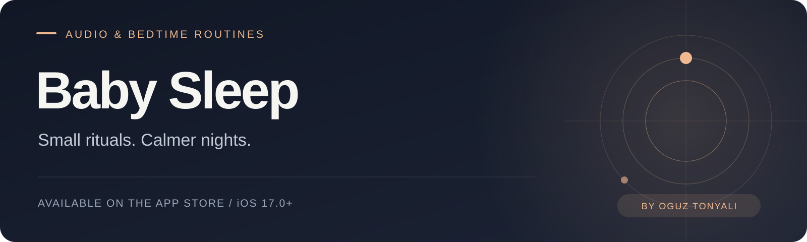
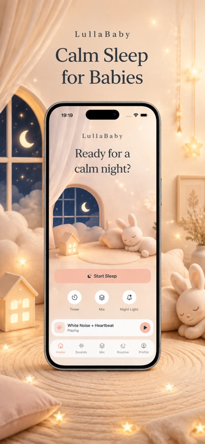
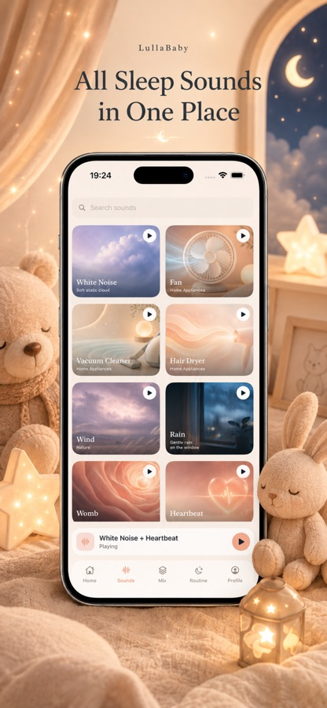
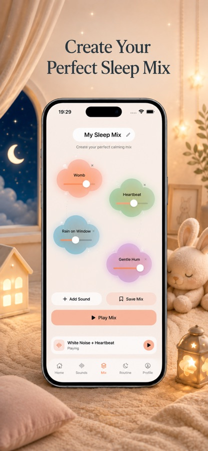

  <a href="https://apps.apple.com/us/app/baby-sleep-white-noise-shush/id6806052285"><strong>View on the App Store ↗</strong></a> &nbsp; · &nbsp;
  <a href="docs/ENGINEERING.md">Engineering notes</a> &nbsp; · &nbsp;
  <a href="https://github.com/Zodomik">More by Oğuz Tonyalı</a>

## Baby Sleep

An offline sound and bedtime companion for parents and caregivers. Build a familiar mix of soothing sounds, add a sleep timer, and return to a favorite routine at the end of the day.

Built and published by **[Oğuz Tonyalı](https://github.com/Zodomik)**. This repository is a public product and engineering showcase; the application source is maintained privately.

## A look inside

  
  
  

*Official product previews from the [App Store listing](https://apps.apple.com/us/app/baby-sleep-white-noise-shush/id6806052285).*

## What you can do

- White, pink and brown noise, shushing, nature sounds and lullabies.
- Layered sound mixes with independent volume controls.
- Background playback, gradual fade-out and sleep timers.
- Saved favorites, custom bedtime routines and a night light.

## Technology

| Area | Technologies | Role in the product |
| --- | --- | --- |
| Interface | Swift, SwiftUI | Sound scenes, mixes, routines and a low-light player. |
| Audio | AVFoundation | Looping playback, audio sessions, mixing and interruption handling. |
| System integration | MediaPlayer | Now Playing information and remote playback controls. |
| Local state | Codable, UserDefaults | Saved mixes, routines, preferences and sleep logs. |
| Purchases | RevenueCat | Premium entitlement, localized offerings and restore flow. |

## Engineering highlights

### Audio that outlives the screen

The audio manager owns playback independently of visible views. Background audio configuration, interruption handling and remote controls support the locked-screen listening flow.

### A mix as reusable data

A saved mix describes selected sounds and their levels. Keeping that model separate from playback lets the same combination be recalled from favorites and bedtime routines.

### Offline content delivery

Bundled audio makes the listening experience available after installation without an account or content download. The app keeps routine and preference state locally.

→ **[Explore the architecture and design decisions](docs/ENGINEERING.md)**

## Try the product

**[Open Baby Sleep on the App Store](https://apps.apple.com/us/app/baby-sleep-white-noise-shush/id6806052285)** · Requires iOS 17.0 or later.

Availability and purchase options are shown in the store. For product support, use the developer links on the App Store listing.

---

[All published apps](https://apps.apple.com/us/developer/oguz-tonyali/id1880078720) · [Developer profile](https://github.com/Zodomik) · [Media credits](assets/SOURCES.md)
