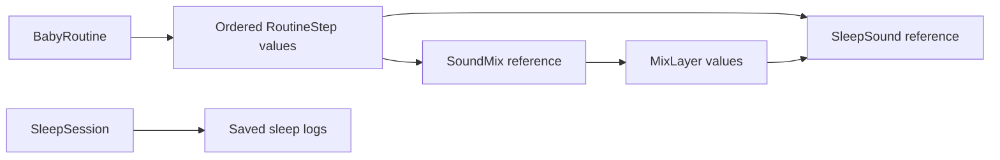

# Baby Sleep · Local data layout

The app uses **Codable structures serialized as JSON data in UserDefaults**. There is no relational backend or SwiftData model in this persistence path.

| Model | Contents |
| --- | --- |
| SleepSound | Static sound ID, category, bundled filename and catalog metadata |
| MixLayer | Layer UUID, sound ID and individual volume |
| SoundMix | Mix identity/name, ordered layers, preset/premium flags and creation time |
| RoutineStep | Step type, sound/mix reference ID, duration and optional note |
| BabyRoutine | Routine identity/name, ordered steps and template metadata |
| SleepSession | Start/end time, mood before sleep, sound title and notes |
| AppSettings | User preferences for the listening experience |

References are IDs resolved by application code, not SQL foreign keys. A routine can refer to a bundled sound or a saved/preset mix. Copying a template gives it a fresh identity for user editing.

## Saved state and recovery

Favorites use a set of sound IDs. Saved routines/mixes/logs are encoded arrays. Sleep-log loading sorts sessions by start time and recovers a session whose end date is absent as the active session. Starting a new session closes a previously active one first.

Starter routines and playlists are seeded using saved flags so repeated launches do not recreate them unconditionally. Defaults also store the selected routine and last-played title.

## Storage trade-off

JSON arrays keep the model small and easy to decode, but updates rewrite an encoded collection. There are no database indexes, joins, migrations or multi-device account synchronization in this layer. The sound files themselves are bundle resources rather than entries in a cloud database.

[Architecture](ENGINEERING.md) · [Audio and scheduling logic](ALGORITHMS.md)
