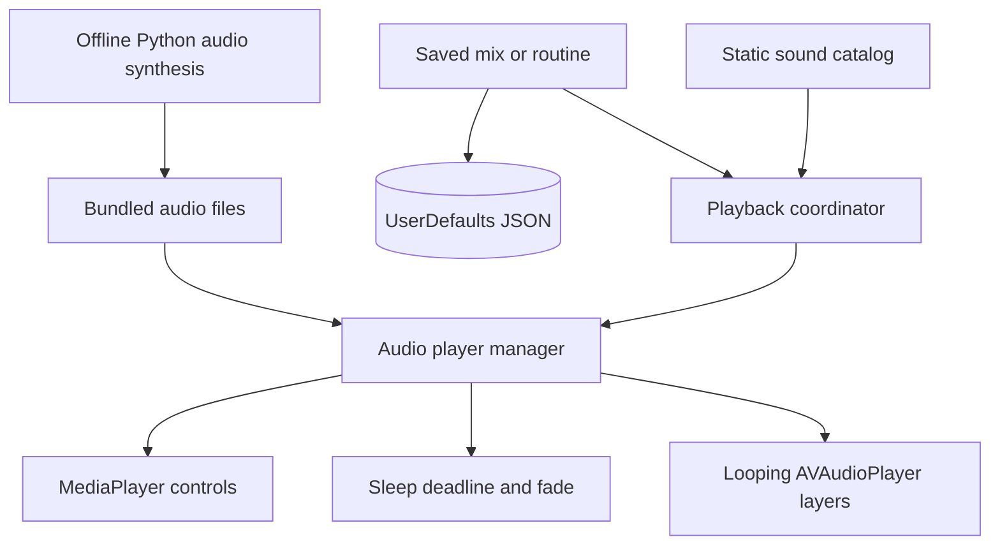

# Baby Sleep · Architecture

*Implementation notes checked against the working project on 20 November 2026. Store builds may differ as the project evolves.*

Baby Sleep—called LullaBaby in the project—is an on-device audio and routine app. Bundled sounds, saved mixes and bedtime state do not require a custom content backend.

| Layer | Technology | Role |
| --- | --- | --- |
| Interface | Swift, SwiftUI, Combine | Sound scenes, mix controls, routines and player state |
| Playback | AVFoundation, AVAudioPlayer, AVAudioSession | One looping player per layer, audio session and interruptions |
| System controls | MediaPlayer | Lock-screen metadata and remote commands |
| Persistence | Codable, JSONEncoder/Decoder, UserDefaults | Saved mixes, routines, logs and preferences |
| Content preparation | Python, NumPy FFT utilities, wave | Offline synthesis of bundled audio assets |
| Purchases | RevenueCat | Premium entitlement, offerings and restore flow |

## Playback ownership

`AudioPlayerManager` owns active players independently of the visible screen. Each layer has a sound ID, player, volume and missing-file state. Master volume and per-layer volume are applied together. Layers can be added or removed while a mix is playing.

`PlaybackCoordinator` resolves a sound/mix/quick-start item and checks access before starting it. `RoutineManager` runs ordered steps, and `SleepLogManager` records sessions. This keeps catalog selection, playback, routine scheduling and log persistence separate.

The audio manager handles system interruptions and audio-route changes, including pausing when an output device is removed. MediaPlayer commands can resume, pause, toggle or stop the same manager.

## Assets are prepared offline

The project includes a Python/NumPy generation script for synthesized noise, filtered textures, rhythmic events and melodies. WAV output is prepared as bundled playback assets. This DSP pipeline runs during content preparation; the shipping app loops audio files instead of running an FFT synthesis server at bedtime.

## Backend and storage

There is no custom API, account database or cloud content service in this audio architecture. Codable structures are serialized to UserDefaults, and the app resolves sound IDs through its static catalog. RevenueCat and Apple remain external purchase services.

Sleep-log statistics are descriptive calculations over saved sessions; they are not a clinical sleep-analysis model.

**Code landmarks:** `AudioPlayerManager`, `PlaybackCoordinator`, `RoutineManager`, `SoundMixManager`, `SleepLogManager`, `SoundCatalog` and the offline audio generator.

**Continue:** [Local data layout](DATA_MODEL.md) · [Audio and scheduling logic](ALGORITHMS.md) · [Product](../README.md)
