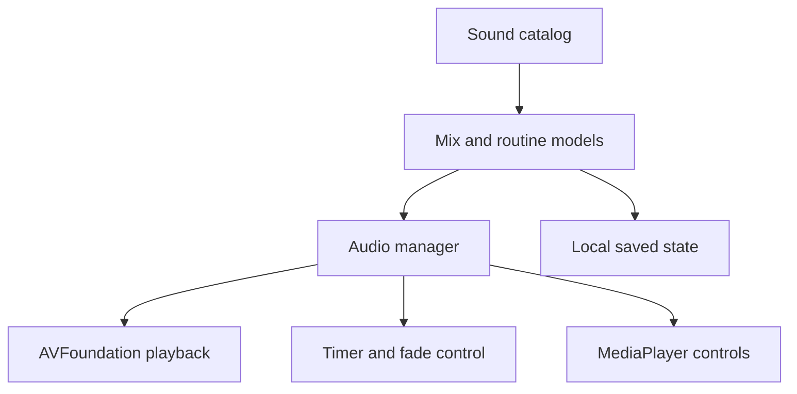

# Baby Sleep · Engineering notes

This overview describes the product’s implementation at a component level. It accompanies the [product showcase](../README.md).

## Component map

The diagram emphasizes responsibilities and data flow. Platform integrations can have their own independent lifecycle.

## Design decisions

### Audio that outlives the screen

The audio manager owns playback independently of visible views. Background audio configuration, interruption handling and remote controls support the locked-screen listening flow.

### A mix as reusable data

A saved mix describes selected sounds and their levels. Keeping that model separate from playback lets the same combination be recalled from favorites and bedtime routines.

### Offline content delivery

Bundled audio makes the listening experience available after installation without an account or content download. The app keeps routine and preference state locally.

## Stack reference

| Area | Technologies | Responsibility |
| --- | --- | --- |
| Interface | Swift, SwiftUI | Sound scenes, mixes, routines and a low-light player. |
| Audio | AVFoundation | Looping playback, audio sessions, mixing and interruption handling. |
| System integration | MediaPlayer | Now Playing information and remote playback controls. |
| Local state | Codable, UserDefaults | Saved mixes, routines, preferences and sleep logs. |
| Purchases | RevenueCat | Premium entitlement, localized offerings and restore flow. |

## Scope

The technology summary was checked against the application’s Swift imports, project configuration and relevant service/model implementations. Backend technologies, where listed, were checked against the associated package manifest and database schema. Store screenshots illustrate the released product; the private working project may continue evolving after release.

This documentation publishes no credentials, deployment configuration, private endpoints or application source. Product behavior and supported devices are described in the [current App Store listing](https://apps.apple.com/us/app/baby-sleep-white-noise-shush/id6806052285).
